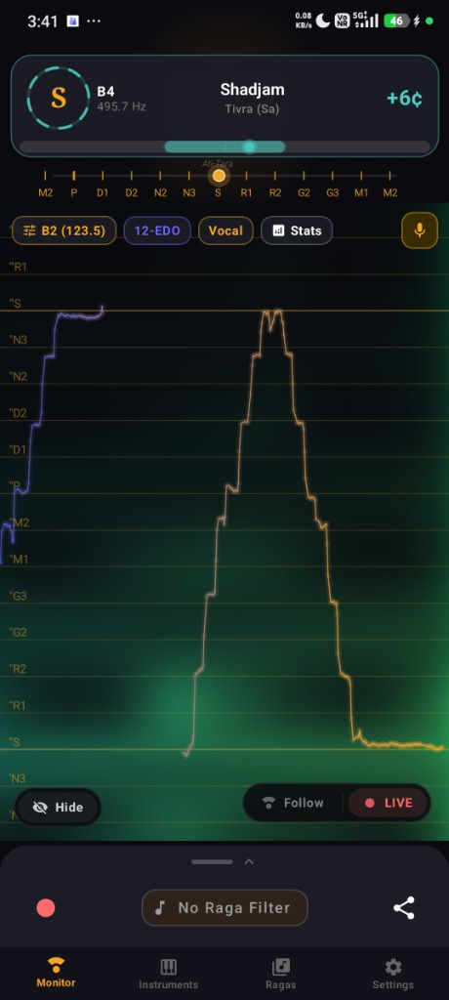
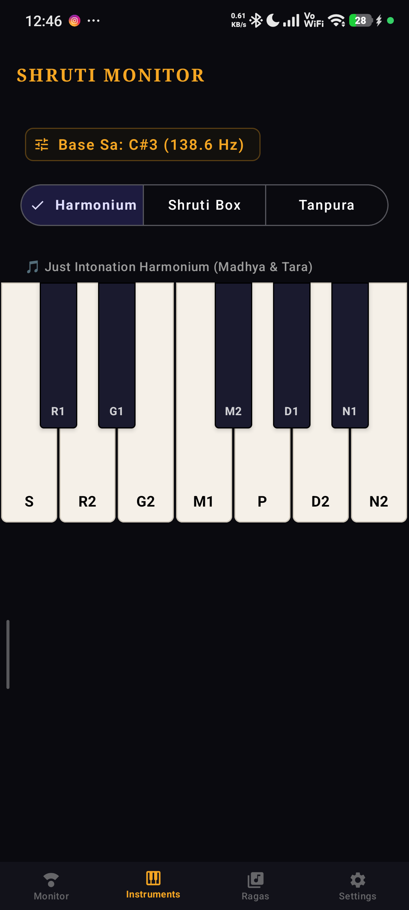
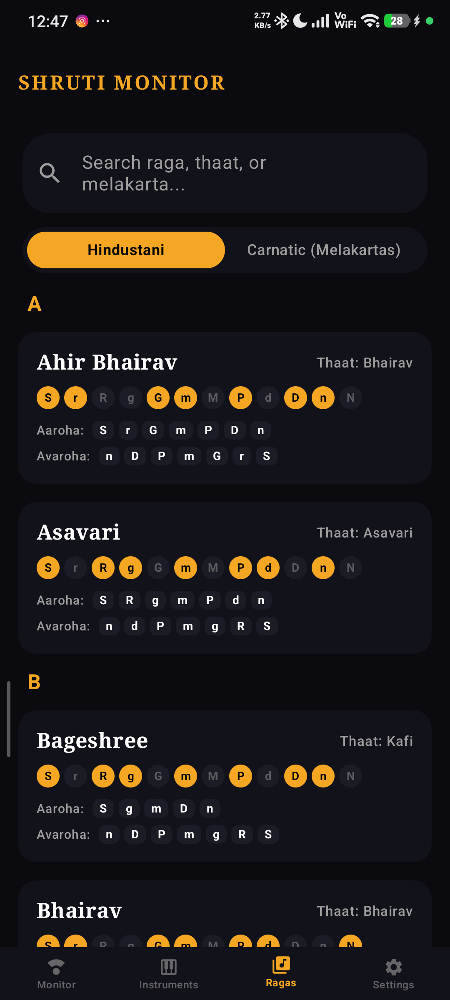
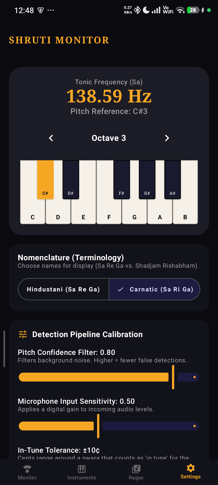
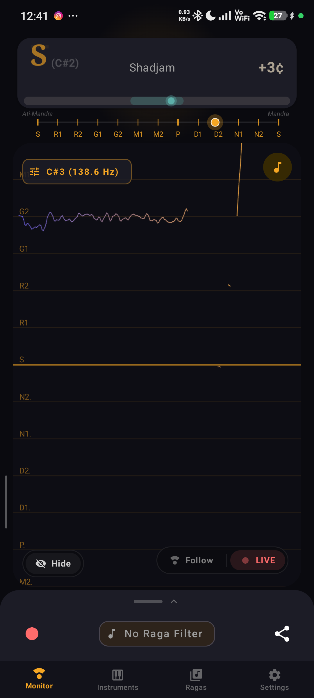
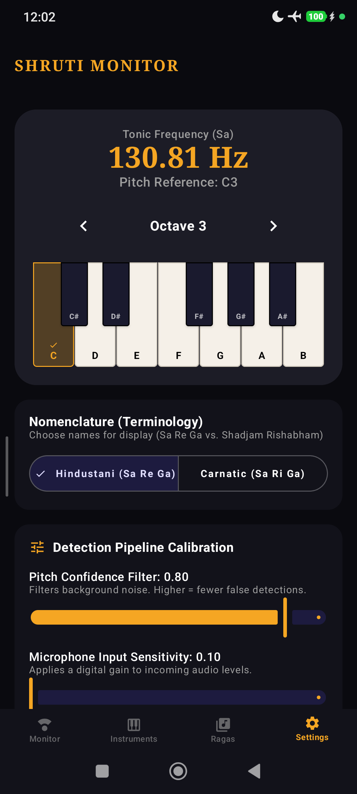

# 📜 Shruti Monitor Changelog

All notable changes to the **Shruti Monitor** application are documented in this file.

---

## [Version 2.1.0] - 2026-11-16

### 🌟 Release Summary
Version 2.1.0 is a milestone architectural release that introduces a native C++ Oboe audio synthesis engine with lossless impulse response soundbanks, background foreground playback service with notification controls, zero-allocation Radix-2 FFT McLeod pitch detection, real-time Gamaka & Meend ornament telemetry, 22-Shruti Sanskrit microtonal mapping, multi-instrument acoustic profiles with dynamic flute register calibration, and an interactive Riyaz Studio with per-swara accuracy scoring, Varjya forbidden note detection, and Ghost-Trace reference overlays.

---

### 🚀 Key Improvements & New Features

#### 1. 🪕 High-Fidelity Native C++ Oboe Audio Engine & Lossless Soundbank
- **Native C++ Audio Streaming**:
  - Replaced the legacy Android `SoundPool` sample player with a high-performance native C++ audio engine (`liboboe.so` via `OboeEngine`).
  - Achieves ultra-low audio latency and artifact-free continuous polyphonic synthesis.
- **Lossless Acoustic Soundbank**:
  - Integrated a high-fidelity 17.7 MB lossless acoustic Tanpura soundbank archive containing pristine impulse responses for male and female pitch registers.
  - Replaced 160 compressed MP3 raw files with uncompressed, low-overhead native asset streaming (`noCompress += ["pak", "wav", "flac"]`).
- **Continuous Microtonal Tonic Sa Synthesis**:
  - Automatically folds any chosen Sa frequency into the optimal sounding MIDI note range ($67..88$) with sub-cent residual pitch tuning and 432 Hz reference alignment.
- **5-String Classical Cycle Mode**:
  - Adds an authentic 5th string (configurable for Pancham, Madhyam, or Nishad/Dhaivat tunings) to the traditional plucking sequence.
- **Dual-Tanpura Jugalbandi Mode**:
  - Layers a secondary acoustic Tanpura voice with subtle stereo panning ($\pm 0.48$) and Mandra/Swar harmonic reinforcement for immersive concert-hall resonance.
- **Non-Linear Javari Bridge Dispersion**:
  - Interactive slider ($0.0\text{¢} - 5.0\text{¢}$) applying microtonal acoustic dispersion between twin *Jod* Madhya Sa strings, producing an authentic shimmering Javari buzz instead of static digital unison.
- **String Pluck Animation Synchronization**:
  - Direct hardware callback dispatches real-time string pluck timestamps to Jetpack Compose for fluid transverse string oscillation animations.

#### 2. 🔊 Background Foreground Playback Service (`DronePlaybackService`)
- **Uninterrupted Riyaz**:
  - Added an Android Media Playback Foreground Service (`DronePlaybackService`) allowing the Tanpura drone to play continuously when switching to other apps or when the screen is locked.
- **Notification Shade Controls**:
  - Ongoing rich media notification displaying current tonic (Sa), octave, and active tuning with one-tap Stop and Play controls.
- **Target SDK 35 & Android 14/15 Compliance**:
  - Fully compliant with `FOREGROUND_SERVICE_MEDIA_PLAYBACK` and `POST_NOTIFICATIONS` runtime permission models.

#### 3. ⚡ Zero-Allocation Radix-2 FFT McLeod Pitch Method (MPM) Engine
- **In-Place Radix-2 Cooley-Tukey FFT ($N=4096$)**:
  - Replaced quadratic $O(N^2)$ direct-time lag searches with $O(N \log N)$ Wiener-Khinchin autocorrelation:
    $$r(t) = \mathcal{F}^{-1}\left(|\mathcal{F}(x)|^2\right)$$
  - Employs an $O(N)$ cumulative square-sum recurrence for the Normalized Square Difference Function (NSDF).
- **Zero-GC Frame Buffer Pool**:
  - `AudioCaptureManager` utilizes a pre-allocated circular pool of 8 reusable 2048-sample audio buffers, eliminating garbage collection pauses and frame drops during live performance.
- **Sub-Sample Parabolic Peak Interpolation**:
  - Computes sub-sample peak location with high clarity thresholding ($0.85$), eliminating octave jump errors.
- **Harmonic Brightness & Overtone Analysis**:
  - Extracts real-time overtone energy ($H_2 + H_3$ vs. fundamental $H_1$) directly from the NSDF half-lag correlation, capturing vocal resonance and timbre.

#### 4. 🎻 Multi-Instrument DSP Acoustic Profiles & Dynamic Flute Register Calibration
- **Dedicated Acoustic Profiles**:
  - **Vocal Riyaz / Voice**: Tuned for human vocal acoustics ($65\text{ Hz} - 1100\text{ Hz}$), clarity threshold $0.85$, RMS noise gate $0.004$.
  - **Bamboo Flute (Dynamic Register)**: Dynamically derives acoustic register from active Sa frequency across 4 distinct registers:
    - *Deep Bass Register* ($<155\text{ Hz}$ Sa): captures deep fundamental resonance with relaxed transient gating.
    - *Bass Register* ($155 - 215\text{ Hz}$ Sa): balances warm low-end tracking with overblown Tara octave protection.
    - *Concert / Medium Register* ($215 - 340\text{ Hz}$ Sa): rejects embouchure breath chuffing and second-harmonic octave jumps.
    - *Soprano / High Register* ($220 - 2800\text{ Hz}$ Sa): tight clarity threshold ($0.93$) for piccolo and high-register bansuris.
  - **Saraswati Veena**: Tuned for plucked acoustic resonance ($70\text{ Hz} - 1400\text{ Hz}$) with fast attack response.
  - **Acoustic Guitar**: Tuned for polyphonic string overtone separation ($75\text{ Hz} - 1350\text{ Hz}$).
- **Instrument Bottom Sheet**:
  - Instant one-tap switching directly from the Pitch Monitor screen via a dedicated instrument modal sheet.

#### 5. 🌊 Gamaka & Meend Real-Time Microtonal Ornament Telemetry
- **Continuous Sliding-Window Analysis**:
  - Evaluates pitch contours over a rolling $460\text{ ms}$ analysis window at $43\text{ Hz}$ hop rate.
- **Ornament Classification**:
  - **Kampita (Oscillation)**: Measures oscillation frequency in Hz and peak-to-peak cent excursion width (e.g. `Kampita ~4.8 Hz (±42¢)`).
  - **Jaaru / Meend (Glide)**: Detects fluid portamento transitions between swarasthanas.
  - **Spurita / Nok (Accent)**: Identifies sharp microtonal touch accents.
  - **Steady Swara**: Indicates sustained tonal stability.
- **Live Display**:
  - Surfaces detected gamaka metrics directly on the Swara Display Card in real time.

#### 6. 🕉️ 22-Shruti (Dvaavimshati Shruti) Canonical Sanskrit Microtonal Mapping
- **Full Canonical Reference Table (`Shruti22`)**:
  - Incorporates the complete 22-Shruti microtonal system from Bharata's *Natyashastra*, Sarangadeva's *Sangita Ratnakara*, and Prof. Sambamoorthy.
- **Live Shruti Identification**:
  - Dynamically calculates nearest microtonal interval and displays the traditional Sanskrit Shruti name (*Tivra, Kumudvati, Manda, Chandovati, Dayavati, Ranjani, Ratika, Raudri, Krodha, Vajrika, Prasarini, Priti, Marjani, Kshiti, Rakta, Sandipini, Alapini, Madanti, Rohini, Ramya, Ugra, Kshobhini*) on the Swara card.

#### 7. 📊 Riyaz Studio, Practice Scorecard & Ghost-Trace Replay Engine
- **Riyaz Practice Scorecard**:
  - Tracks intonation accuracy percentage per swara across all 12 chromatic degrees during active singing.
  - Calculates mean signed cent deviation to identify whether a singer tends sharp or flat on specific swaras.
  - Generates an overall weighted riyaz accuracy score for each practice session.
- **Varjya Swara Real-Time Detection**:
  - Automatically identifies forbidden (*varjya*) swaras that do not belong to the selected Raga.
  - Triggers a prominent floating warning alert badge if a musician sustains a forbidden note for $\ge 275\text{ ms}$ (12 consecutive frames).
- **Session Recording & Ghost-Trace Overlay**:
  - Records sessions as `.m4a` audio with synchronized `.json` telemetry sidecars.
  - **Ghost-Trace Replay**: Overlays a translucent reference pitch contour directly onto the live `PitchGraph`, enabling students to practice along with guru reference recordings or compare takes visually.

#### 8. 🌌 GPU-Accelerated AGSL Aurora Resonance Shaders (Android 13+)
- **Native GPU Shading**:
  - Built with Android Graphics Shading Language (AGSL) running on the GPU at 60/120 FPS on Android 13, 14, and 15.
- **Reactive Acoustic Plasma Field**:
  - Visual resonance background reacts dynamically to vocal volume (RMS amplitude), harmonic overtone brightness, and intonation accuracy (blossoming into Mint Emerald when locking into swarasthanas).
- **Multi-Layer Trace Bloom**:
  - Rendered with wide atmospheric plasma bloom, mid glow trace, core sharp trace, and glowing live target dot.

#### 9. 🎹 Enhanced Tonic (Sa) Calibration & Carnatic Kattai Strip
- **Carnatic Kattai / Safed Quick-Select Strip**:
  - Direct one-tap buttons for standard pitch standards: 1 Kattai (C), 1½ (C#), 2 (D), 2½ (D#), 3 (E), 4 (F), 4½ (F#), 5 (G), 5½ (G#), 6 (A), 6½ (A#), 7 (B).
- **Micro-Step Frequency Tuning**:
  - Precision buttons for `-1 Hz`, `-0.1 Hz`, `+0.1 Hz`, and `+1 Hz` fine adjustments.
- **Unrestricted Pitch Range**:
  - Full chromatic keyboard spanning octaves 2 through 5 without artificial sample limits.

---

## [Version 1.2.0] - 2026-09-08

### 🌟 Release Summary
Version 1.2.0 introduces multi-system mathematical tuning presets (Harmonic 5-Limit Just Intonation, Pythagorean 3-Limit Just Intonation, and 12-Tone Equal Temperament), decoupling nomenclature from the tuning engine with intelligent tradition defaults. It also adds a native in-app software update checker and one-click package installer.

---

### 🚀 Key Improvements & New Features

#### 1. 🎼 Multi-System Mathematical Tuning Engine
- **Harmonic (5-Limit JI)**:
  - Uses pure harmonic thirds and fifths ($G_2 = 6/5$, $D_1 = 8/5$, $N_2 = 9/5$).
  - Produces $G_2$ at $315.64\text{¢}$, eliminating acoustic beating against the Tanpura drone; ideal for Hindustani music, bansuri, and vocal riyaz.
- **Pythagorean (3-Limit JI)**:
  - Derived via the cycle of continuous fourths and fifths ($G_2 = 32/27$, $D_1 = 128/81$, $N_2 = 16/9$).
  - Produces $G_2$ at $294.13\text{¢}$, exactly $21.51\text{¢}$ (Pramāna Shruti / Syntonic Comma) flatter than 5-limit intervals.
  - Aligns with traditional Carnatic Veena swarasthana charts and classical treatises (*Venkatamakhin's Chaturdandi Prakasika*, Sambamoorthy).
- **12-Tone Equal Temperament (12-EDO / Western)**:
  - Standard chromatic reference with equal 100¢ semitones ($G_2 = 300.0\text{¢}$) for practicing alongside keyboards, pianos, and Western tempered instruments.
- **Real-Time Visual Grid Remapping**:
  - Horizontal pitch canvas gridlines dynamically interpolate and align with the active tuning system in real time.
- **Floating Quick-Switch Chip**:
  - Direct one-tap cycling chip on the Pitch Monitor screen allows musicians to toggle tuning presets instantly during performance or riyaz.

#### 2. 🎛️ Decoupled Nomenclature & Intelligent Defaults
- **Separate Nomenclature & Tuning Controls**:
  - The swara naming convention (`Hindustani [Sa Re Ga]` vs. `Carnatic [Sa Ri Ga]`) is completely decoupled from the acoustic tuning engine.
- **Smart Tradition Defaults**:
  - Selecting Carnatic nomenclature defaults to **Pythagorean (3-Limit JI)**.
  - Selecting Hindustani nomenclature defaults to **Harmonic (5-Limit JI)**.
  - If a musician explicitly chooses a tuning preset, their preference is locked and preserved across tradition and raga switches.

#### 3. 🔄 Native In-App Software Updates & One-Click Installer
- **Background Checks**: Automatically checks GitHub Releases on launch (throttled to once every 24 hours).
- **Update Dialog**: Presents release notes / changelog, download size, and real-time streaming download progress bar.
- **One-Click Installation**: Downloads to application cache and triggers native Android package installation via secure `FileProvider`.
- **Manual Check**: Added a dedicated "Software Updates" row with status indicator in Settings -> About.

---

## [Version 1.1.1] - 2026-09-08

### 🌟 Release Summary
Version 1.1.1 resolves a critical state preservation and navigation issue where the Tanpura drone playback state was lost when navigating across tabs, and ensures bottom tab navigation cleanly restores screen state.

---

### 🚀 Bug Fixes & Improvements

#### 1. 🪕 Tanpura Playback State Synchronization Across Navigation
- **Root-Cause Fix**: `PlayViewModel` previously defaulted `tanpuraPlaying` to `false` and lacked reactive observation of the background `TanpuraSynthesizer` sequencer thread.
- **Live State Flow**: `TanpuraSynthesizer` now provides an observable `isPlaying: StateFlow<Boolean>` that stays synchronized with the physical synthesis thread. `PlayViewModel` subscribes to this state and initializes directly from the synthesizer's live state.
- **Reliable Toggle**: Tapping the Tanpura button directly checks the engine's physical running status instead of inverting a local flag, eliminating desynchronized button states.
- **Uninterrupted Riyaz**: Removed synthesizer teardown on screen disposal so the Tanpura drone continues playing continuously in the background while musicians practice and monitor pitch on the Monitor tab.
- **App Lifecycle Cleanup**: Added `onDestroy()` in `MainActivity` to release audio synthesizer resources when the app is completely exited.

#### 2. 🧭 Bottom Tab Navigation Backstack Restoration
- **Root-Cause Fix**: Bottom navigation tab clicks previously targeted the already-popped splash screen route for `popUpTo`, causing navigation to fail to pop destinations and continuously inflate the backstack with duplicate screens on every tab switch.
- **Proper State Preservation**: All tab navigation and Ragas navigation now pop up to `Screen.Monitor.route` with `saveState = true` and `restoreState = true`, cleanly preserving tab state, scroll positions, and instrument selections.

---

## [Version 1.1.0] - 2026-09-06

### 🌟 Release Summary
Version 1.1.0 is a landmark audio and graphics engine overhaul for Shruti Monitor. It completely transforms the real-time pitch tracking experience, delivering fluid, continuous vocal pitch contours matching professional reference monitors while preserving Indian classical music nuances (*meend*, *gamakas*, microtonal *shrutis*).

---

### 📸 Release Screenshots

  
  
  

  
  
  

---

### 🚀 Key Improvements & New Features

#### 1. 🎙️ Continuous, Fluid Vocal Pitch Curve
- **Root-Cause Fix**: Eliminated the median filter and exponential moving average (EMA) that previously quantized diagonal vocal glides into artificial vertical/horizontal "staircases".
- **Pure Parabolic Peak Passthrough**: Uses McLeod Pitch Method (MPM) with sub-sample parabolic interpolation, plotting true natural vocal intonation without lag.
- **Hardware-Accelerated Batched Rendering**: Replaced individual path allocations with OpenGL/Vulkan batched `drawLines`, maintaining a locked 60/120 FPS render loop.

#### 2. ⚡ Time-Aware Dynamic Pitch Discontinuity Rule
- **Adaptive Velocity Gating**: In previous builds, static cent jump caps fragmented rapid descending scales and fast *taans*. The new rule calculates maximum allowable pitch delta dynamically based on actual elapsed frame time:
  $$\Delta c_{\text{max}} = \max\left(250\text{¢},\, \min\left(500\text{¢},\, 6000\text{¢/s} \times \Delta t_{\text{actual}}\right)\right)$$
- **Musical Coherence**: Preserves intentional musical transitions and rapid pitch bends (*gamakas*) as continuous lines while cleanly breaking across genuine octave leaps or musical pauses.

#### 3. 🛡️ Dual-Threshold Voicing Hysteresis (Schmitt Trigger)
- **Attack Threshold (`0.82`)**: Requires high confidence to enter voicing, completely rejecting room fan rumble, breath intakes, and ambient Tanpura acoustic bleed during silence.
- **Sustain/Decay Threshold (`0.70`)**: Once voiced, the required threshold drops by $0.12$ to follow soft vocal endings, delicate *nyasa* notes, and quiet low chest resonance (*Mandra Saptak*) without premature dropouts.

#### 4. 🌉 Micro-Gap Visual Bridging
- Detects transient single-frame detector dropouts ($\le 80\text{ ms}$) caused by acoustic cancellation or room reflections.
- Visually bridges micro-gaps to maintain continuous visual traces during sustained singing, while strictly respecting genuine musical silence ($> 80\text{ ms}$).

#### 5. ⏱️ Hardware Audio Capture Timestamps
- Audio capture timestamps from Android's `AudioRecord` hardware buffer are now stamped at ingestion and carried directly to the canvas coordinate mapping (`timeMs - minTimeMs`).
- Eliminates horizontal frame jitter caused by Android OS thread scheduling and variable garbage-collection pauses.

#### 6. 👆 1-Finger Vertical Pan & Viewport Navigation
- When **Auto-Follow** is disabled, musicians can freely touch and drag the pitch canvas up or down with one finger to inspect any octave (*Ati-Mandra* to *Taar Saptak*).
- Added smooth drag velocity handling without interfering with horizontal timeline tracking.

#### 7. 🎯 Accurate Swara Cent Tuning Display
- Fixed cent deviation readout in the top Swara Card to show the exact microtonal deviation from the current active Just Intonation swara instead of cumulative cents from Sa.
- Instant color-coded feedback (Mint Green for in-tune, Amber/Red for off-pitch) with configurable in-tune tolerance ($\pm 5\text{¢}$ to $\pm 25\text{¢}$).

#### 8. 📊 In-Memory Telemetry & Diagnostics
- Added a lightweight, circular diagnostic telemetry buffer (`PitchPipelineTelemetry`) capturing sample timestamps, raw frequencies, confidence scores, and RMS energy for ongoing acoustic performance validation.

---

## [Version 1.0.0] - 2026-09-04

### Initial Public Release
- **Real-Time Pitch Detector**: McLeod Pitch Method (MPM) 50 Hz – 2000 Hz real-time audio capture.
- **Microtonal Just Intonation Engine**: 22-Shruti scale mapping for Hindustani and Carnatic classical systems.
- **High-Fidelity Tanpura Drone**: Sample-based 4-string acoustic sequencer with tempo, fine-tuning (±50¢), and A4=432Hz switch.
- **Just Intonation Harmonium**: Interactive touch keyboard supporting Madhya and Tara saptaks.
- **Comprehensive Raga Explorer**: 100+ Hindustani and Carnatic ragas with scale structures, vadi, samvadi, and aaroha/avaroha.
- **Session Recorder**: High-quality practice recording with direct system share sheet integration.
