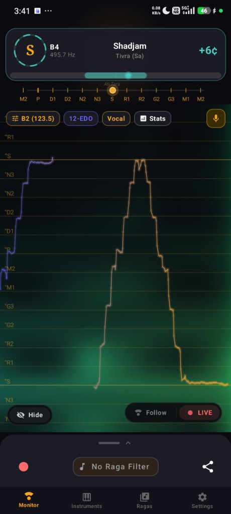
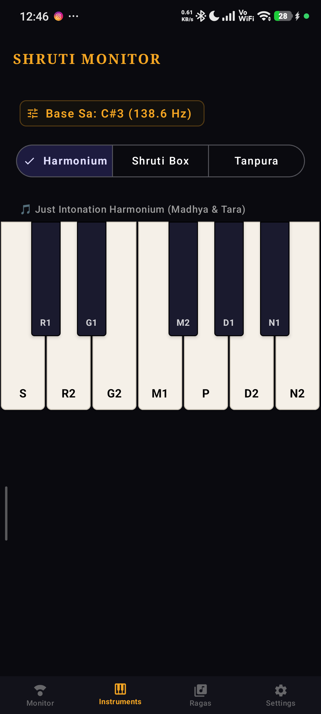
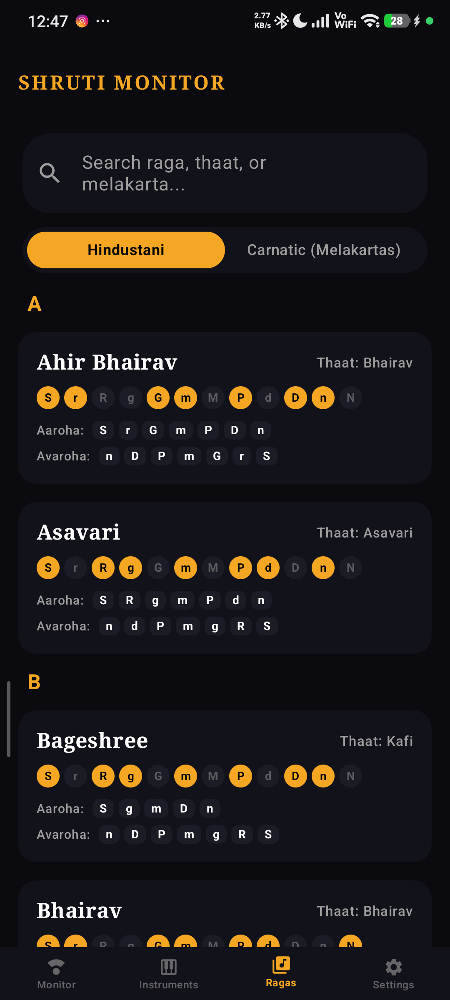
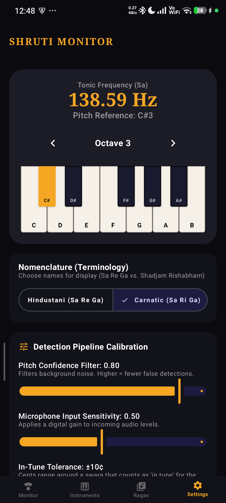

# Shruti Monitor (श्रुति मॉनिटर / சுருதி மானிட்டர்)

[](https://github.com/hari2897/shruti-monitor-android/releases)
[-3DDC84?style=for-the-badge&logo=android&logoColor=white)](https://developer.android.com)
[](https://kotlinlang.org)
[](https://developer.android.com/jetpack/compose)
[](https://github.com/google/oboe)
[](LICENSE)

An advanced, high-performance Android application engineered for Indian classical vocalists and instrumentalists (Carnatic and Hindustani). **Shruti Monitor** combines an ultra-low latency, zero-allocation real-time pitch monitor with a **Native C++ Oboe Audio Engine**, 22-Shruti Sanskrit microtonal mapping, Gamaka/Meend ornament classification, multi-instrument acoustic profiles, and an interactive Riyaz Studio practice suite with Ghost-Trace session replay.

<p align="center">
  
</p>

---

## 📸 Screen Previews

<p align="center">
  
  
  
  
</p>

---

## 📑 Table of Contents

- [✨ What's New in Version 2.1.0](#-whats-new-in-version-210)
- [🚀 Quick Install (No Tech Skills Needed)](#-quick-install-no-tech-skills-needed)
- [📖 Feature Guide](#-feature-guide)
  - [1. Setting Reference Tonic (Sa) & Carnatic Kattai](#1-setting-reference-tonic-sa--carnatic-kattai)
  - [2. Real-Time Pitch Monitor & Microtonal Canvas](#2-real-time-pitch-monitor--microtonal-canvas)
  - [3. Gamaka & Meend Telemetry Analyzer](#3-gamaka--meend-telemetry-analyzer)
  - [4. 22-Shruti (Dvaavimshati Shruti) Sanskrit Mapping](#4-22-shruti-dvaavimshati-shruti-sanskrit-mapping)
  - [5. High-Fidelity Native C++ Tanpura Drone](#5-high-fidelity-native-c-tanpura-drone)
  - [6. Background Foreground Playback Service](#6-background-foreground-playback-service)
  - [7. Multi-Instrument DSP Profiles & Dynamic Flute Register Calibration](#7-multi-instrument-dsp-profiles--dynamic-flute-register-calibration)
  - [8. Riyaz Practice Studio & Ghost-Trace Replay](#8-riyaz-practice-studio--ghost-trace-replay)
  - [9. Multi-System Mathematical Tuning Engine](#9-multi-system-mathematical-tuning-engine)
- [🔬 Mathematical & DSP Foundations](#-mathematical--dsp-foundations)
- [🏛️ Architecture & Tech Stack](#️-architecture--tech-stack)
- [🛠️ Developer Corner (Build from Source)](#️-developer-corner-build-from-source)
- [📜 Changelog History](#-changelog-history)
- [📄 License & Credits](#-license--credits)

---

## ✨ What's New in Version 2.1.0

### 🪕 High-Fidelity Native C++ Oboe Audio Engine & Lossless Soundbank
- **Native C++ Audio Streaming**: Driven by a high-performance native audio engine (`liboboe.so` via `OboeEngine`), replacing the legacy Android SoundPool sequencer with direct, low-latency, glitch-free audio streaming.
- **Lossless Acoustic Soundbank**: Integrated a 17.7 MB archive of lossless acoustic impulse responses. 160 legacy compressed MP3 assets have been completely phased out in favor of uncompressed native asset streaming.
- **Continuous Microtonal Tonic Sa Synthesis**: Automatically folds any chosen Sa frequency into the optimal sounding MIDI range ($67..88$) with sub-cent residual pitch shifts and 432 Hz natural frequency support.
- **5-String Classical Cycle Mode**: Plucks an authentic 5th string (Pancham, Madhyam, or Nishad/Dhaivat) in the traditional sequence.
- **Dual-Tanpura Jugalbandi Mode**: Layers a secondary acoustic Tanpura voice with subtle stereo panning ($\pm 0.48$) and harmonic reinforcement for lush concert-hall resonance.
- **Non-Linear Javari Bridge Dispersion**: Dedicated slider ($0.0\text{¢} - 5.0\text{¢}$) applying microtonal dispersion between twin *Jod* Madhya Sa strings, generating natural acoustic Javari shimmer rather than digital phase cancellation.
- **String Pluck Animation Sync**: Direct hardware callbacks synchronize plucks with real-time transverse string vibrations in Jetpack Compose.

### 🔊 Background Foreground Playback Service (`DronePlaybackService`)
- **Uninterrupted Riyaz**: The Tanpura drone continues running continuously in the background when switching apps or locking your device.
- **Notification Controls**: Ongoing media notification with current Tonic (Sa), octave, tuning, and one-tap Stop/Play controls. Fully compliant with Android 14/15 media playback foreground service policies.

### ⚡ Zero-Allocation Radix-2 FFT McLeod Pitch Method (MPM) Engine
- **Wiener-Khinchin Autocorrelation**: Replaced quadratic $O(N^2)$ direct-time search with in-place Radix-2 Cooley-Tukey FFT ($N=4096$) computing autocorrelation in $O(N \log N)$ time, combined with an $O(N)$ cumulative square-sum recurrence.
- **Zero-GC Frame Buffer Pool**: Pre-allocated circular pool of 8 reusable 2048-sample audio buffers in `AudioCaptureManager`, eliminating garbage collection pauses and frame drops during live performance.
- **Sub-Sample Parabolic Interpolation**: Refines peak locations with sub-sample precision to eliminate octave jumping errors.
- **Harmonic Brightness & Overtone Analysis**: Real-time extraction of overtone energy ($H_2 + H_3$ vs. fundamental $H_1$) directly from the Normalized Square Difference Function (NSDF) half-lag correlation.

### 🎻 Multi-Instrument DSP Profiles & Dynamic Flute Register Calibration
- **Dedicated Instrument Profiles**:
  - **Vocal Riyaz / Voice**: Tuned for human vocal acoustics ($65\text{ Hz} - 1100\text{ Hz}$), clarity threshold $0.85$, RMS noise gate $0.004$.
  - **Bamboo Flute (Dynamic Register)**: Dynamically derives acoustic register from active Sa frequency across 4 distinct registers:
    - *Deep Bass Register* ($<155\text{ Hz}$ Sa): captures deep fundamental resonance with relaxed transient gating.
    - *Bass Register* ($155 - 215\text{ Hz}$ Sa): balances warm low-end tracking with overblown Tara octave protection.
    - *Concert / Medium Register* ($215 - 340\text{ Hz}$ Sa): rejects embouchure breath chuffing and second-harmonic octave jumps.
    - *Soprano / High Register* ($220 - 2800\text{ Hz}$ Sa): tight clarity threshold ($0.93$) for piccolo and high-register bansuris.
  - **Saraswati Veena**: Tuned for plucked acoustic resonance ($70\text{ Hz} - 1400\text{ Hz}$) with fast attack response.
  - **Acoustic Guitar**: Tuned for polyphonic string overtone separation ($75\text{ Hz} - 1350\text{ Hz}$).
- **Instrument Modal Sheet**: Quick one-tap switching directly from the Pitch Monitor screen.

### 🌊 Gamaka & Meend Real-Time Microtonal Ornament Analyzer
- **Sliding-Window Telemetry**: Evaluates pitch contours over a rolling $460\text{ ms}$ analysis window at $43\text{ Hz}$ frame hop rate.
- **Ornament Classification**:
  - **Kampita (Oscillation)**: Computes oscillation rate in Hz and peak-to-peak cent excursion width (e.g. `Kampita ~4.8 Hz (±42¢)`).
  - **Jaaru / Meend (Glide)**: Detects continuous portamento transitions across swarasthanas.
  - **Spurita / Nok (Accent)**: Identifies sharp microtonal touch accents.
  - **Steady Swara**: Indicates sustained tonal stability.
- Displayed directly on the Swara Display Card in real time.

### 🕉️ 22-Shruti (Dvaavimshati Shruti) Sanskrit Microtonal System
- **Complete Canonical Reference Table (`Shruti22`)**: Incorporates the full 22-Shruti microtonal system based on Bharata's *Natyashastra*, Sarangadeva's *Sangita Ratnakara*, and Prof. Sambamoorthy.
- **Live Shruti Identification**: Maps live vocal pitch to exact classical Sanskrit Shruti names (*Tivra, Kumudvati, Manda, Chandovati, Dayavati, Ranjani, Ratika, Raudri, Krodha, Vajrika, Prasarini, Priti, Marjani, Kshiti, Rakta, Sandipini, Alapini, Madanti, Rohini, Ramya, Ugra, Kshobhini*).

### 📊 Riyaz Practice Studio, Scorecard & Ghost-Trace Replay
- **Intonation Practice Scorecard**:
  - Live intonation accuracy percentage per swara across all 12 chromatic swarasthanas.
  - Mean signed cent deviation calculation to detect whether a singer leans sharp or flat on specific swaras.
  - Overall weighted riyaz accuracy score.
- **Varjya Swara Real-Time Warning**:
  - Automatically identifies forbidden (*varjya*) swaras that do not belong to the selected active Raga.
  - Displays a prominent floating alert badge if a musician sustains a forbidden note for $\ge 275\text{ ms}$ (12 consecutive frames).
- **Ghost-Trace Visual Replay**:
  - Overlays a translucent reference pitch contour directly onto the live `PitchGraph` from saved recordings, enabling students to practice along with guru reference recordings or compare takes visually.

### 🌌 GPU-Accelerated AGSL Aurora Resonance Shaders (Android 13+)
- **Hardware-Accelerated AGSL Shaders**: Android Graphics Shading Language shaders executing directly on the GPU at 60/120 FPS on Android 13, 14, and 15.
- **Reactive Acoustic Plasma Field**: Visual resonance background reacts dynamically to vocal volume (RMS amplitude), harmonic overtone brightness, and intonation accuracy (blooming into Mint Emerald when locking into swarasthanas).
- **Multi-Layer Trace Bloom**: Rendered with wide atmospheric plasma bloom, mid glow trace, core sharp trace, and glowing live target dot.

### 🎹 Enhanced Tonic (Sa) Calibration & Carnatic Kattai Strip
- **Carnatic Kattai / Safed Quick-Select Strip**: Direct one-tap buttons for standard pitch standards: 1 Kattai (C), 1½ (C#), 2 (D), 2½ (D#), 3 (E), 4 (F), 4½ (F#), 5 (G), 5½ (G#), 6 (A), 6½ (A#), 7 (B).
- **Micro-Step Frequency Tuning**: Precision buttons for `-1 Hz`, `-0.1 Hz`, `+0.1 Hz`, and `+1 Hz` fine adjustments.
- **Unrestricted Pitch Range**: Full chromatic keyboard spanning octaves 2 through 5 without artificial sample limits.

---

## 🚀 Quick Install (No Tech Skills Needed)

If you want to use Shruti Monitor on your Android phone, you do not need to build it from source. You can download and install it in one click:

1. **Download the Installer (APK)**:
   - On your Android phone, click this direct download link:  
     👉 [**Download ShrutiMonitor-v2.1.0.apk (Direct Link)**](https://github.com/hari2897/shruti-monitor-android/releases/download/v2.1.0/ShrutiMonitor-v2.1.0.apk)
   - Or, go to the [**Releases**](https://github.com/hari2897/shruti-monitor-android/releases) section and download the latest `.apk` file.

2. **Open the File**:
   - Once downloaded, pull down your notification tray or open your phone's **Files** / **Downloads** app, and tap `ShrutiMonitor-v2.1.0.apk`.

3. **Allow Installation**:
   - If your phone displays *"For your security, your phone is not allowed to install unknown apps from this source"*, tap **Settings** in that dialog and toggle **Allow from this source**.
   - Tap **Install** when prompted.

4. **Launch the App**:
   - Once installed, tap **Open** or find the **Shruti Monitor** icon on your home screen or app drawer!

---

## 📖 Feature Guide

### 1. Setting Reference Tonic (Sa) & Carnatic Kattai
Before singing or playing the Tanpura, set your reference pitch (Tonic / Sa):
- Tap the **Tonic Card** at the top of the screen (or navigate to **Settings**).
- **Carnatic Kattai Quick-Select**: Tap any Kattai button in the scrollable top bar (`1 Kattai C`, `1½ C#`, `2 D`, `4 F`, `5 G`, etc.) to jump instantly to traditional pitch settings.
- **Micro-Step Fine Tuning**: Use the `-1 Hz`, `-0.1 Hz`, `+0.1 Hz`, or `+1 Hz` buttons for microtonal calibration to match an acoustic harmonium, flute, or acoustic tanpura.
- **Piano Strip & Octaves**: Tap keys directly on the responsive 1-octave keyboard strip (C through B) and use the octave chevrons to move between Octaves 2, 3, 4, and 5.

### 2. Real-Time Pitch Monitor & Microtonal Canvas
- Go to the **Monitor** tab and tap the **Microphone Toggle Button** to activate monitoring.
- Sing or play an instrument. A continuous, fluid glowing line traces your pitch on the microtonal grid in real time.
- **Microtonal Grid**: Horizontal lines represent the precise Just Intonation (*Gandhar*, *Madhyam*, *Pancham*, etc.) swaras.
- **In-Tune Target Feedback**: When maintaining your pitch within tolerance (e.g. $\pm 10\text{ cents}$), the note indicator glows bright mint-green, a progress circle animates to completion, and your device produces a gentle haptic tick.
- **Scrolling Tuner Tape**: The top horizontal scale displays swaras from Sa to Sa across octaves (*Mandra*, *Madhya*, *Tara*), sliding smoothly under the thumb with boundary hysteresis.

### 3. Gamaka & Meend Telemetry Analyzer
- As you sing expressive Indian classical ornaments, the **Swara Display Card** automatically detects and classifies microtonal movement:
  - **Kampita (Oscillation)**: Shows the live oscillation frequency and peak-to-peak cent width (e.g., `Kampita ~5.2 Hz (±48¢)`).
  - **Jaaru / Meend (Glide)**: Identifies graceful glides between notes.
  - **Spurita (Accent)**: Captures sudden microtonal touches.
  - **Steady Swara**: Confirms steady tone hold.

### 4. 22-Shruti (Dvaavimshati Shruti) Sanskrit Mapping
- Shruti Monitor maps detected pitches to the classical 22-Shruti canonical system in real time.
- View classical Sanskrit Shruti names (*Tivra*, *Kumudvati*, *Manda*, *Chandovati*, *Dayavati*, *Ranjani*, *Ratika*, etc.) directly below the note abbreviation on the Swara card.

### 5. High-Fidelity Native C++ Tanpura Drone
- Navigate to the **Instruments** tab and tap **START**.
- **Plucking Speed & Volume**: Adjust the plucking speed factor ($0.5\times$ to $2.0\times$) and volume.
- **First String (Jiva)**: Select **Pancham (Pa)**, **Madhyam (Ma)**, or **Nishad (Ni)** depending on the raga.
- **5-String Classical Cycle**: Toggle the 5th string switch to expand the plucking cycle to 5 strings.
- **Dual Tanpura Jugalbandi**: Toggle to layer a secondary acoustic Tanpura with stereo pan for concert-hall presence.
- **Javari Bridge Dispersion Slider**: Fine-tune the microtonal bridge dispersion between $0.0\text{¢}$ and $5.0\text{¢}$ to create warm, authentic Javari shimmer.
- **432 Hz Mode**: Instantly shifts the pitch reference from A4=440 Hz to natural A4=432 Hz.
- **Transverse String Vibrations**: Watch the physical string animation oscillate dynamically with every pluck.

### 6. Background Foreground Playback Service
- Start the Tanpura drone in the **Instruments** tab and feel free to lock your phone or switch to lyric/sheet music apps.
- The drone continues playing continuously without stutter.
- Pull down the Android notification shade to view current tuning and pause/resume playback instantly.

### 7. Multi-Instrument DSP Profiles & Dynamic Flute Register Calibration
- Tap the **Instrument Chip** on the Monitor screen:
  - **Vocal Riyaz**: Optimized for human voice dynamics.
  - **Bamboo Flute**: Dynamically derives acoustic register from active Sa frequency across 4 registers (*Deep Bass*, *Bass*, *Concert*, *Soprano*) to reject breath turbulence and prevent second-harmonic octave jumps.
  - **Saraswati Veena**: Tuned for plucked acoustic transients.
  - **Acoustic Guitar**: Tuned for acoustic string resonance.
- Toggle GPU AGSL Aurora Resonance Shaders on or off based on visual preference.

### 8. Riyaz Practice Studio & Ghost-Trace Replay
- Tap the **Studio (Analytics) Button** on the Monitor screen:
  - **Practice Scorecard**: View overall intonation accuracy percentage, total voiced frames, and per-swara accuracy & mean signed cent deviation.
  - **Varjya Swara Warnings**: When practicing a specific Raga from the Ragas Explorer, singing a forbidden (*varjya*) note for $\ge 275\text{ ms}$ triggers an immediate visual warning badge.
  - **Recorded Sessions**: Review saved riyaz recordings with audio playback and delete old takes.
  - **Ghost-Trace Replay**: Tap the **Ghost-Trace icon** on any session to overlay that session's pitch contour in translucent cyan on the live pitch monitor. Sing along to master tracks and visually align your intonation with reference recordings!

### 9. Multi-System Mathematical Tuning Engine
- Quick-switch between tuning systems directly via the floating tuning chip on the Pitch Monitor screen:
  - **Harmonic (5-Limit Just Intonation)**: Pure harmonic thirds & fifths ($G_2 = 6/5$, $D_1 = 8/5$, $N_2 = 9/5$). Eliminates acoustic beating against the Tanpura drone ($G_2 = 315.6\text{¢}$).
  - **Pythagorean (3-Limit Just Intonation)**: Derived via continuous fifths and fourths ($G_2 = 32/27$, $D_1 = 128/81$, $N_2 = 16/9$). Exactly $21.51\text{¢}$ (Pramāna Shruti / Syntonic Comma) flatter than 5-limit intervals, matching traditional Carnatic Veena swarasthana charts ($G_2 = 294.1\text{¢}$).
  - **12-Tone Equal Temperament (12-EDO)**: Western standard equal 100¢ semitones ($G_2 = 300\text{¢}$) for practicing alongside piano and western keyboards.
- **Decoupled Nomenclature**: Switch between Hindustani (`Sa Re Ga`) and Carnatic (`Sa Ri Ga`) swara names independently of the underlying mathematical tuning.

---

## 🔬 Mathematical & DSP Foundations

### Radix-2 FFT McLeod Pitch Method (MPM)
The Normalized Square Difference Function (NSDF) $n_t(\tau)$ is computed via the Wiener-Khinchin theorem:
$$r_t(\tau) = \mathcal{F}^{-1}\left(|\mathcal{F}(x)|^2\right)$$
$$m_t(\tau) = \sum_{j=0}^{W-1} \left(x_{t+j}^2 + x_{t+j+\tau}^2\right)$$
$$n_t(\tau) = \frac{2\, r_t(\tau)}{m_t(\tau)}$$

Sub-sample parabolic peak interpolation around the chosen peak $\tau_k$:
$$\delta = \frac{n_t(\tau_k - 1) - n_t(\tau_k + 1)}{2 \left(n_t(\tau_k - 1) - 2 n_t(\tau_k) + n_t(\tau_k + 1)\right)}$$
$$f_0 = \frac{f_s}{\tau_k + \delta}$$

### 22-Shruti Canonical Ratios & Cents

| # | Shruti Name | Swara | Mathematical Ratio | Cents (¢) |
|---|-------------|-------|-------------------|-----------|
| 1 | **Tivra** | Shadjam (Sa) | $1/1$ | $0.00$ |
| 2 | **Kumudvati** | Komal Rishabh (R1-) | $256/243$ | $90.22$ |
| 3 | **Manda** | Shuddh Rishabh (R1+) | $16/15$ | $111.73$ |
| 4 | **Chandovati** | Chatusruti Rishabh (R2-) | $10/9$ | $182.40$ |
| 5 | **Dayavati** | Panchasruti Rishabh (R2+) | $9/8$ | $203.91$ |
| 6 | **Ranjani** | Sadharana Gandhara (G2-) | $32/27$ | $294.13$ |
| 7 | **Ratika** | Antara Gandhara (G2+) | $6/5$ | $315.64$ |
| 8 | **Raudri** | Chatusruti Gandhara (G3-) | $5/4$ | $386.31$ |
| 9 | **Krodha** | Tivra Gandhara (G3+) | $81/64$ | $407.82$ |
| 10 | **Vajrika** | Shuddh Madhyam (M1-) | $4/3$ | $498.04$ |
| 11 | **Prasarini** | Tivra Madhyam (M1+) | $27/20$ | $519.55$ |
| 12 | **Priti** | Prati Madhyam (M2-) | $45/32$ | $590.22$ |
| 13 | **Marjani** | Tivratara Madhyam (M2+) | $729/512$ | $611.73$ |
| 14 | **Kshiti** | Panchamam (Pa) | $3/2$ | $701.96$ |
| 15 | **Rakta** | Komal Dhaivat (D1-) | $128/81$ | $792.18$ |
| 16 | **Sandipini** | Shuddh Dhaivat (D1+) | $8/5$ | $813.69$ |
| 17 | **Alapini** | Chatusruti Dhaivat (D2-) | $5/3$ | $884.36$ |
| 18 | **Madanti** | Panchasruti Dhaivat (D2+) | $27/16$ | $905.87$ |
| 19 | **Rohini** | Kaisiki Nishada (N2-) | $16/9$ | $996.09$ |
| 20 | **Ramya** | Kakali Nishada (N2+) | $9/5$ | $1017.60$ |
| 21 | **Ugra** | Tivra Nishada (N3-) | $15/8$ | $1088.27$ |
| 22 | **Kshobhini** | Tivratara Nishada (N3+) | $243/128$ | $1109.78$ |

---

## 🏛️ Architecture & Tech Stack

```
com.shrutimonitor.app
├── audio
│   ├── AudioCaptureManager.kt      # Zero-GC circular buffer pool (8 x 2048 samples)
│   ├── McLeodPitchDetector.kt      # Radix-2 FFT MPM Wiener-Khinchin pitch engine
│   ├── GamakaAnalyzer.kt           # Real-time sliding-window Gamaka classifier
│   ├── RiyazScorecardTracker.kt    # Intonation statistics & Varjya note detector
│   ├── SessionLibraryManager.kt    # Session recording audio playback & Ghost-Trace
│   ├── SwaraMapper.kt              # 22-Shruti and Just Intonation mapping
│   ├── TanpuraSynthesizer.kt       # Native OboeEngine bridge & sequencer
│   └── DronePlaybackService.kt     # Media playback foreground service
├── data
│   ├── InstrumentProfile.kt        # Vocal, Flute, Veena, Guitar acoustic profiles
│   ├── TuningPreset.kt             # Harmonic, Pythagorean, 12-EDO & 22-Shruti tables
│   ├── RagaData.kt                 # Aaroha/Avaroha and Raga metadata
│   └── SettingsRepository.kt       # Jetpack DataStore preferences
├── ui
│   ├── monitor
│   │   ├── MonitorScreen.kt        # Primary real-time pitch monitor view
│   │   ├── PitchGraph.kt           # GPU-accelerated pitch trace & Ghost-Trace
│   │   ├── SwaraDisplayCard.kt     # Swara, 22-Shruti, Gamaka & Cent indicator
│   │   ├── InstrumentFluteSheet.kt # Instrument & Flute register selector
│   │   ├── RiyazStudioSheet.kt     # Practice scorecard & Ghost-Trace replay
│   │   └── AgslPitchShaders.kt     # Native Android AGSL GPU shader
│   ├── play
│   │   ├── PlayScreen.kt           # Instruments tab host
│   │   ├── TanpuraView.kt          # 5-String, Dual-Tanpura & Javari controls
│   │   └── ShrutiPettiView.kt      # Multi-reed harmonium drone
│   └── settings
│       └── SaPickerView.kt         # Tonic picker, Kattai bar & micro-step tuning
```

---

## 🛠️ Developer Corner (Build from Source)

### Prerequisites
- **JDK 17** (Temurin or OpenJDK)
- **Android SDK** (API 35+ / Target SDK 35)
- **Android NDK** (C++ toolchain supporting `arm64-v8a`)

### Build Instructions
Clone the repository and compile using the Gradle wrapper:

```bash
# Clone the repository
git clone https://github.com/hari2897/shruti-monitor-android.git
cd shruti-monitor-android

# Run all unit tests
./gradlew testDebugUnitTest

# Assemble debug APK
./gradlew assembleDebug
```

The output APK will be generated at:  
`app/build/outputs/apk/debug/app-debug.apk`

### Installing via ADB
```bash
adb install -r app/build/outputs/apk/debug/app-debug.apk
```

---

## 📜 Changelog History

Detailed release logs and changelogs are maintained in [**CHANGELOG.md**](CHANGELOG.md).

- **v2.1.0** (2026-11-16): Native C++ Oboe Audio Engine, 17.7 MB Lossless Soundbank, 5-String Cycle, Dual-Tanpura Jugalbandi, Javari Dispersion, Background Drone Service, Zero-Allocation Radix-2 FFT MPM, Multi-Instrument DSP Profiles, Dynamic Flute Register Calibration, Gamaka & Meend Telemetry, 22-Shruti Sanskrit Mapping, Riyaz Practice Scorecard, Varjya Swara Detection, Ghost-Trace Session Replay, AGSL Aurora Shaders, Carnatic Kattai Strip & Micro-Step Frequency Tuning.
- **v1.2.0** (2026-09-08): Multi-System Mathematical Tuning Presets (Harmonic 5-Limit, Pythagorean 3-Limit, 12-EDO), Decoupled Nomenclature, Floating Quick-Switch Tuning Chip, Native In-App Software Updates & One-Click Package Installer.
- **v1.1.1** (2026-09-08): Tanpura Playback State Synchronization across Navigation, Backstack Restoration, and Lifecycle Cleanup.
- **v1.1.0** (2026-09-06): Continuous Fluid Vocal Pitch Curve, Time-Aware Dynamic Pitch Discontinuity, Dual-Threshold Voicing Hysteresis, Micro-Gap Visual Bridging, Hardware Capture Timestamps.

---

## 📄 License & Credits

- **License**: Released under the [MIT License](LICENSE).
- **Acoustic Soundbank & Engine**: Built with native C++ Oboe audio streaming and lossless acoustic impulse soundbanks.
- **Indian Classical Music Theory**: Based on the canonical microtonal systems of Bharata's *Natyashastra*, Sarangadeva's *Sangita Ratnakara*, and Prof. Sambamoorthy.
